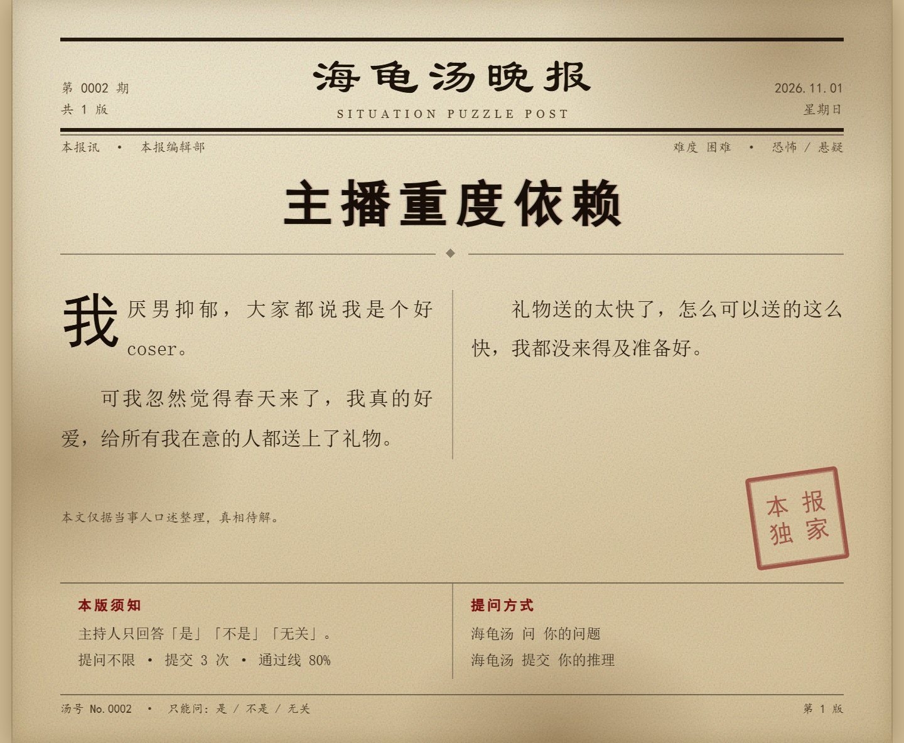

# @bigxingyun/koishi-plugin-soup

> 把 Koishi 机器人变成 24 小时在线的海龟汤主持人。

玩家只问「是 / 不是 / 无关」，AI 主持人当场给判词；提交推理时按「关键要素命中 + 语义一致」打出相似度分，过线即揭汤底。汤面默认印成一张做旧报纸号外，发不出去就自动退回文字——玩家不会察觉。

不用等人主持、不用背汤底、不会说漏嘴。一锅汤十几分钟打完，适合群里随手开一局。



[](https://www.npmjs.com/package/@bigxingyun/koishi-plugin-soup)
[](https://github.com/bigxingyun/koishi-plugin-soup/blob/main/LICENSE)

## 特性

- **判词收敛**：模型只能回 `是 / 不是 / 无关`，输出走 JSON 白名单，其余一律丢弃
- **相似度评分**：汤底拆关键要素（权重可调）+ 语义分，按 6:4 加权，可解释
- **配额管理**：公共提问 / 公共提交 / 个人提交三层配额，用数据库求值表达式原子扣减，并发不超扣
- **报纸汤面**：默认把汤面渲染成做旧报纸图，渲染不可用时**自动降级纯文本**，玩家无感
- **AI 版面规划**：每锅汤的引题、副题、主色、印章由模型决定，版式由代码算（不会排版塌陷）
- **三级指令**：`海龟汤` → `海龟汤 汤库` → `海龟汤 汤库 重载`，管理功能全部收进分组

## 一局怎么玩

```
玩家：海龟汤 开局
bot ：〈一张报纸号外，印着汤面〉

玩家：海龟汤 问 她是不是被分尸了
bot ：是

玩家：海龟汤 提交 榜一发现被骗钱后潜入她家把她分尸，把尸块当礼物寄出去了
bot ：相似度 94%（通过线 80%）— 通过！〈公布汤底〉
```

提问次数、提交次数、通过线、单场时长都能按频道单独设置；开启「个人提交次数」后会多出一个 60 秒的加入窗口，变成多人轮流押注的房间模式。

## 安装

```sh
npm i @bigxingyun/koishi-plugin-soup
```

在 Koishi 控制台「插件配置」里启用，然后：

1. **填 API Key**：配置项 `apiKey`（或环境变量 `DEEPSEEK_API_KEY`）
2. **绑主人**：群里发 `海龟汤 主人 绑定`，到**控制台日志**里取 6 位密钥，再发 `海龟汤 主人 绑定 <密钥>`
3. **放汤**：首次启动会自动铺 3 锅样例汤到 `data/soup/tales/`，可随意删改；也可自己放 JSON 后发 `海龟汤 汤库 重载`

想要出图，额外装 `koishi-plugin-puppeteer`（可选，没装只发文本）。

| 项 | 要求 |
| --- | --- |
| Koishi | `^4.18.11` |
| Node.js | ≥ 18（依赖全局 `fetch`） |
| 数据库 | 必需，SQLite / MySQL / PostgreSQL / MongoDB 均可 |
| 出图 | 可选，需要 `koishi-plugin-puppeteer` + 系统中文字体 |

## 指令

| 指令 | 说明 |
| --- | --- |
| `海龟汤` | 当前场次摘要 |
| `海龟汤 开局 [汤名]` | 开始一局；`-t` 强制纯文本 |
| `海龟汤 问 <问题>` | 提问，只回 是 / 不是 / 无关 |
| `海龟汤 提交 <推理>` | 提交推理，返回相似度 |
| `海龟汤 加入` / `开始` | 房间模式加入 / 提前开始 |
| `海龟汤 汤面` `汤底` `状态` `结束` | 重发汤面 / 看汤底 / 进度 / 提前结束 |
| `海龟汤 战绩 [-s]` | 最近战绩 |
| `海龟汤 汤库` | 汤库列表（`列表` / `查看` / `启用` / `停用` / `删除` / `导入` / `重载`） |
| `海龟汤 主人` | 绑定与设置（`绑定` / `解绑` / `设置`） |
| `海龟汤 渲染` | 出图状态（`状态` / `测试` / `开启` / `关闭` / `主题`） |
| `海龟汤 诊断 [-f]` | 测 AI 站点连通性：Key、`/models`、模型名、能否真正跑一次推理 |

旧写法 `海龟汤 绑定`、`海龟汤 设置` 仍可用一次，会提示迁移到三段式。

## 汤文件格式

放在 `data/soup/tales/*.json`，单文件可放一条或数组：

```json
{
  "taleId": "additive-harm",
  "title": "添加剂危害",
  "difficulty": "normal",
  "tags": ["恐怖", "社会派"],
  "surface": "汤面正文，允许 Markdown，不允许 HTML",
  "answer": "汤底全文",
  "keys": [
    { "text": "摊主超量添加食品添加剂", "weight": 2 },
    { "text": "第一周年糕用了超标合成色素", "weight": 1 }
  ]
}
```

| 字段 | 必填 | 说明 |
| --- | --- | --- |
| `taleId` | ✅ | 小写字母/数字/连字符，3~64 位，全局唯一 |
| `title` | ✅ | 汤名，≤ 40 字 |
| `surface` | ✅ | 汤面，10~8000 字 |
| `answer` | ✅ | 汤底，10~10000 字 |
| `keys` | ❌ | 关键要素 1~8 条，缺省时评分退化为纯语义分 |
| `difficulty` | ❌ | `easy` / `normal` / `hard` |
| `tags` | ❌ | 最多 8 个 |
| `newspaper` | ❌ | 手工版面覆盖，写了就不再调 AI |

完整 JSON Schema：[`docs/schema/tale.schema.json`](https://github.com/bigxingyun/koishi-plugin-soup/blob/main/docs/schema/tale.schema.json)。

导入时会做三件事：**清洗 HTML/代码围栏**、**校验字段**、**泄底检测**（汤面含汤底 ≥12 字原句时拒绝导入）。

> 从 0.1.0 升级：数据目录由 `data/situation-puzzle/` 改为 `data/soup/`。若新目录尚未创建而老目录里已有汤，插件会自动继续读老目录，无需手动迁移。

## 配置要点

| 配置 | 默认 | 说明 |
| --- | --- | --- |
| `model` | `deepseek-flash` | 官方当前对应 V4.1-Flash |
| `thinkingMode` | `false` | 关掉思考模式：判词要稳定，且思考模式下 `temperature` 不生效 |
| `defaultGuessQuota` | `3` | 公共提交次数 |
| `defaultQuestionQuota` | `0` | 提问次数，0 表示不限 |
| `personalGuessQuota` | `0` | >0 时启用房间模式 |
| `passThreshold` | `0.8` | 通过相似度 |
| `renderMode` | `image-first` | 图片优先，失败降级文本 |
| `renderFormat` | `jpg` | PNG 体积约为 JPEG 的 6 倍 |
| `seedBundled` | `true` | 汤库为空时自动铺 3 锅内置样例汤 |

全部 44 项配置及默认值见[需求规格](https://github.com/bigxingyun/koishi-plugin-soup/blob/main/需求分析.md) §7。

## 常见问题

**Q：没配 Key 能用吗？**
能开局、能看汤面，但 `问` 和 `提交` 会提示「尚未配置 AI 服务」。汤库管理、配额、结算逻辑都不依赖 AI。

**Q：没装 puppeteer 会怎样？**
一直发纯文本，功能完整。装了但渲染失败（比如容器缺中文字体）也会自动降级，不会报错给玩家。

**Q：判词不稳定怎么办？**
先把 `temperature` 保持 0.2 左右、`thinkingMode` 关掉；同一场次里重复的问题会被缓存，不会两次给不同答案。仍不满意可以换 `deepseek-v4-pro`（贵约 6 倍）。

**Q：为什么我的汤导入失败了？**
`海龟汤 汤库 重载` 会打印失败原因。最常见的是汤面里出现了汤底的原句（泄底检测），或 `taleId` 重复。

**Q：能一锅汤玩多局吗？**
能，汤库按 `playedCount` 优先抽没玩过的；同一频道同一时刻只允许一场。

## 开发

```sh
npm install
npm run build      # 编译到 lib/
npm test           # 41 个用例：单元 + mock 集成 + 渲染 + 路由 + 出图
npm run typecheck
```

测试用 `@koishijs/plugin-mock` + 内存数据库，并用假 `fetch` 顶掉真实的模型调用，**不需要联网也不需要 API Key**。

版式与版面规划的实现参考在 [`docs/render-sample/`](https://github.com/bigxingyun/koishi-plugin-soup/tree/main/docs/render-sample)，需求规格见 [`需求分析.md`](https://github.com/bigxingyun/koishi-plugin-soup/blob/main/需求分析.md)。

### 真实出图验证（需要本机 Chrome）

```sh
npm run verify:render      # 或：$env:CHROME_PATH="D:\chrome\chrome.exe"; node scripts/verify-render.js
```

脚本会起一个无头 Koishi 应用（mock 适配器 + 内存数据库 + `@koishijs/plugin-http` + `koishi-plugin-puppeteer`），
自动发送一次 `海龟汤 开局`，把插件**实际发出**的图片落到 `docs/verify/real-render.jpg`；没有收到图片就以非零码退出。

> 两个只在裸 Context 里才会遇到的坑：`koishi-plugin-puppeteer` 声明了 `inject = ['http']`，必须先装
> `@koishijs/plugin-http`；另外它提供的服务在 `ready` 之后才真正就绪，脚本里要等一会儿再发消息。
> 正常 Koishi 应用这两个条件都天然满足。

## 已知限制

- 长汤面（>1200 字）会缩字号，仍过长时降级文本；尚未按高度自适应
- 汤面里的 Markdown 标题 / 表格暂不解析，会按纯文本渲染
- `en-US` 文案只有骨架

## 更新日志

- **0.2.0** — 内置 3 锅样例汤随包发布，首次启动自动铺入；新增 `海龟汤 诊断` 站点连通性测试；AI 输出的版面会做泄底检测
- **0.1.1** — 数据目录改为 `data/soup/`（自动兼容老目录）；README 补效果图与 FAQ
- **0.1.0** — 首个可用版本：三级指令、配额、AI 判词与评分、报纸图渲染与降级

## License

[MIT](https://github.com/bigxingyun/koishi-plugin-soup/blob/main/LICENSE)
