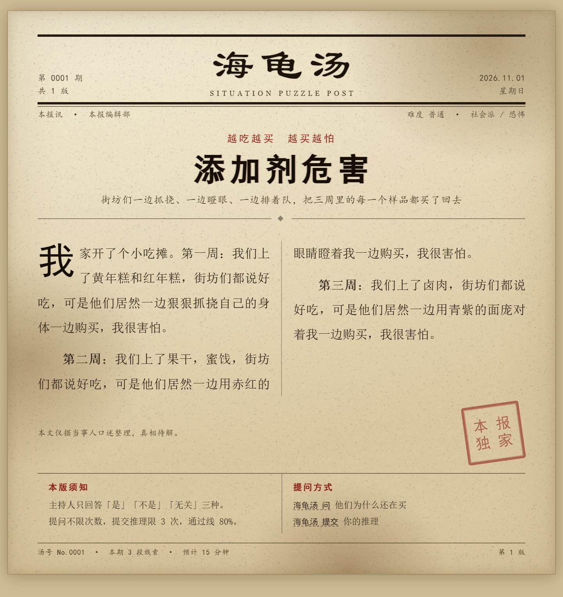
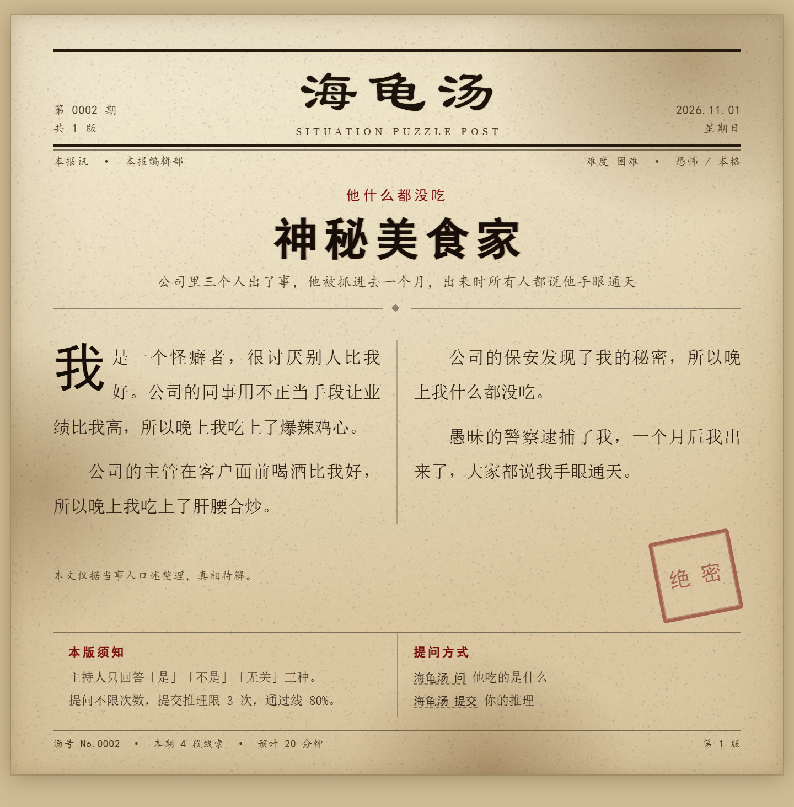
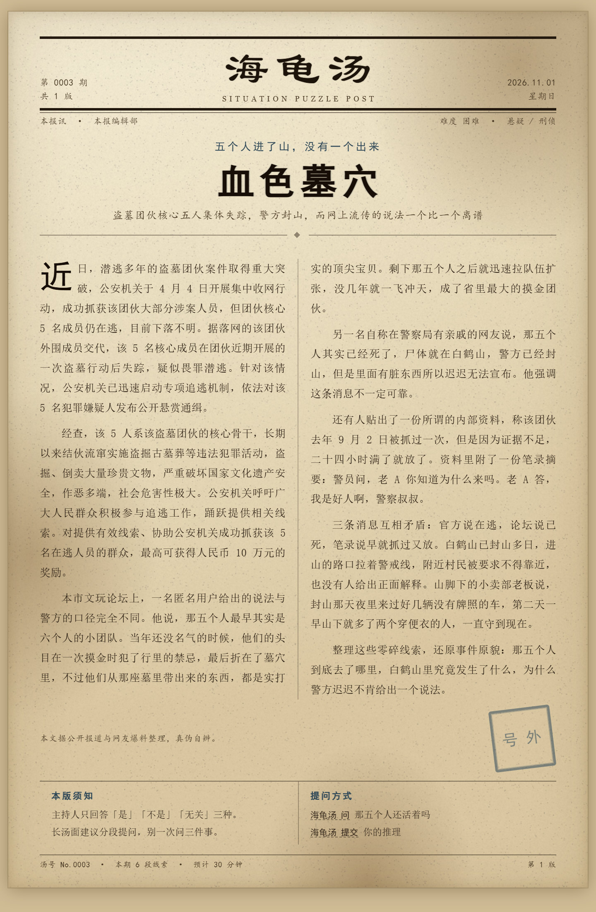

# 汤面「做旧报纸」渲染：模板 + 版面规划

对应需求：`需求分析.md` §5 **FR-16**（报纸图渲染）、**FR-17**（AI 版面规划）、§7 分组六/七。

本目录是**可运行的参考实现 + 样张**，不是插件代码。插件里要做的只有两件事：
1. 把 `template/newspaper.tpl.html` 复制进 `src/render/`，当字符串模板用；
2. 把 `build.py` 的「plan → 填模板」逻辑翻译成 TypeScript（逻辑很短，见文末）。

## 样张

| 样张 | 汤 | 展示的是什么 |
| --- | --- | --- |
|  | 添加剂危害（195 字） | 默认版式；短稿自动放大到 15.8px 填版 |
|  | 神秘美食家（156 字） | 换成 `blood` 暗红主色 + 「绝密」印章 |
|  | 血色墓穴（869 字） | 长稿自动压到 13.1px，仍保双栏，页高 2203px |

> 三张图共用同一个模板，差异全部来自 `plans/*.json` 里的 5 个字段（accent / stamp / fontPx / columns / deck）。

## 目录

```text
render-sample/
├── template/newspaper.tpl.html   唯一模板，占位符 {{TITLE}} 等
├── plans/                        版面规划（LayoutPlan）
│   ├── 01-additive-harm.json
│   ├── 02-hannibal.json
│   └── 03-bloody-tomb.json
├── build.py                      plan → HTML（含校验、夹紧、自动字号）
├── render.ps1                    一把梭：plan → HTML → Chrome 截图 → 裁白边
├── crop.py                       按底色裁掉截图留白
├── make-textures.py              生成纸纹与污渍贴图
├── to-jpg.py                     PNG → JPEG 并打印体积
├── layout-plan.schema.json       AI 输出契约
├── AI-LAYOUT.md                  为什么只让 AI 调「编辑决策」+ 可直接用的 prompt
└── tex/                          grain.png / blot1.png / blot2.png
```

## 复现

```powershell
cd docs\render-sample
.\render.ps1                    # 渲染 plans/ 下全部
.\render.ps1 02-hannibal        # 只渲染一锅
```

脚本依赖：本机 Chrome、Pillow、numpy。截图必须 `--force-device-scale-factor=2`，否则 720px 宽的中文会发虚。

## 体积

| 样张 | PNG | JPEG q86 | 尺寸 |
| --- | --- | --- | --- |
| 01 添加剂危害 | 2161 KB | **337 KB** | 1440×1526 |
| 02 神秘美食家 | 2057 KB | **319 KB** | 1440×1463 |
| 03 血色墓穴 | 3392 KB | **596 KB** | 1440×2203 |

→ `renderFormat` 默认 `jpg` 就来自这组数据：PNG 是 JPEG 的 6 倍，上传慢且部分平台拒收。

## 版面规划（LayoutPlan）

AI 只输出 JSON，排版由 `build.py` 确定性计算。契约见 [`layout-plan.schema.json`](layout-plan.schema.json)，设计理由见 [`AI-LAYOUT.md`](AI-LAYOUT.md)。

```json
{
  "kicker": "越吃越买　越买越怕",
  "title": "添加剂危害",
  "deck": "街坊们一边抓挠、一边瞪眼、一边排着队，把三周里的每一个样品都买了回去",
  "body": ["第一段…", "第二段…"],
  "style": { "columns": 2, "accent": "rust" },
  "stamp": { "text": "本报独家" }
}
```

三档优先级：**手工在汤 JSON 里写死** > **AI 生成的 plan（入库缓存）** > **代码推导的默认值**。

## 插件里的等价实现（TS 伪代码）

```ts
const accent = ACCENTS[plan.style?.accent ?? 'rust']        // 只认白名单
const bodyLen = plan.body.join('').length
const fontPx = clamp(autoFontSize(bodyLen), 12, 16.5)        // 越界夹紧，不报错
const html = TEMPLATE
  .replaceAll('{{TITLE}}', escapeHtml(plan.title))
  .replaceAll('{{BODY_HTML}}', plan.body.map(p => `<p>${escapeHtml(p)}</p>`).join(''))
  // …
```

两个必须照做的点：

1. **一切文本都 `escapeHtml`**，模板里禁止拼接原始 HTML；
2. 渲染前 `page.setRequestInterception(true)` 并阻断所有外部请求——否则汤面里一个 `` 就是一次 SSRF。

## 两个已踩过的坑

1. **首字下沉会把下一段挤出一个洞**：首段必须 `text-indent: 0` 且长度 ≥ 2 行，否则浮动块吃不满，下一段左侧留白。
2. **印章不能 `position: absolute`**：会压住正文尾行。改成与尾行同一个 `flex` 容器，靠右对齐。

## TODO（插件阶段）

- [ ] 字号改成**渲染后量高度**，超 `renderMaxHeight` 再降一档（现在用字数阈值，只是近似）
- [ ] `tex/*.png` 改成内联 SVG `feTurbulence`（`grain.png` 单文件就 414 KB）
- [ ] 汤面里的 Markdown（`##`、表格、引用）先转纯段落，`汤/血色墓穴.md` 属此类
- [ ] plan 缓存键带上模板版本号，模板一改全体失效
